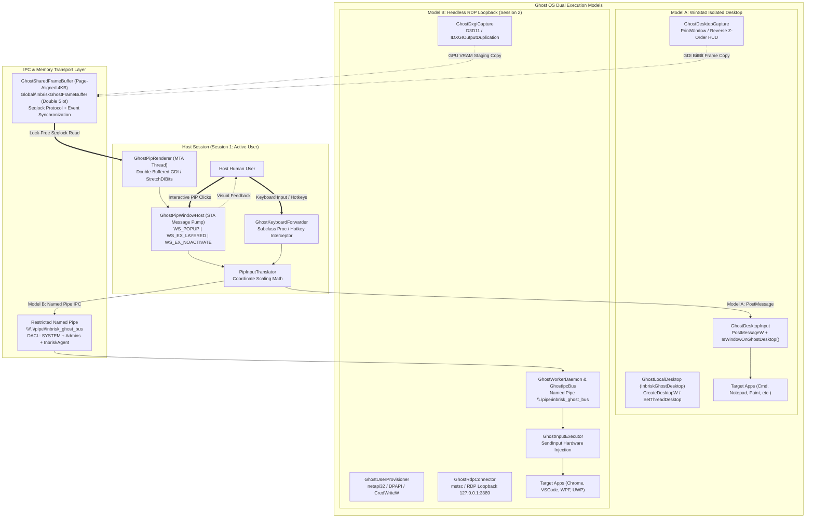
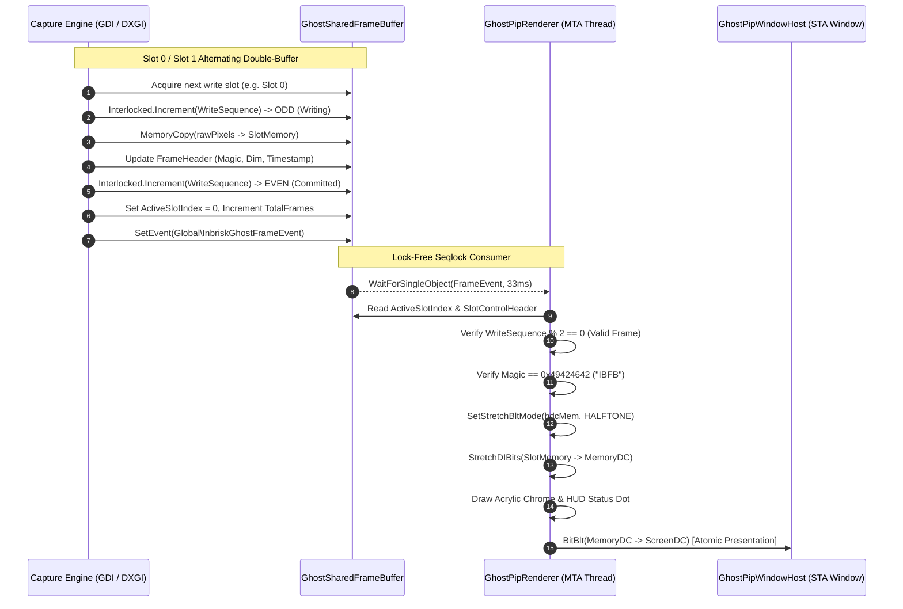

# Inbrisk Ghost OS: System Architecture Specification

## Executive Summary

The **Ghost OS** subsystem in Inbrisk provides an isolated, autonomous Windows execution environment that allows AI agents to interact with graphical desktop applications, command-line interfaces, and web browsers concurrently with human user activity. Traditional desktop automation tools seize control of the physical mouse cursor, keyboard focus, and primary display monitor, causing immediate disruption to human workflows. Ghost OS resolves this fundamental limitation by establishing an isolated execution boundary decoupled from the active human desktop, combined with a real-time, low-overhead **Picture-in-Picture (PiP)** video streaming and input-forwarding pipeline.

Ghost OS implements a **Dual Execution Model**:
1. **WinSta0 Isolated Desktop (`InbriskGhostDesktop`)**: A lightweight, zero-credential Win32 desktop object hosted within the interactive window station `WinSta0`. Ideal for lightweight Win32/Console automation, running seamlessly under standard user privileges.
2. **Headless RDP Loopback Session (Session 2 / Terminal Services)**: A full secondary Windows user session connected over `127.0.0.1:3389` running as a dedicated local service account (`InbriskAgent`). Provides complete hardware DirectX 11 GPU acceleration, high-performance DXGI Desktop Duplication, and unrestricted UI Automation (UIA) access.

The real-time visual output of the isolated environment is delivered to the host user via an acrylic, click-through, double-buffered PiP overlay powered by a lock-free shared memory ring buffer (`GhostSharedFrameBuffer`) supporting resolutions up to 4K at 60 FPS. Bidirectional interactive input is translated and dispatched with sub-millisecond latency while enforcing cryptographic security boundaries and desktop validation barriers to eliminate cross-session data or input leaks.



---

## 1. Dual Execution Model: Architecture & Mechanics

### 1.1 Architecture Deep Dive: WinSta0 Isolated Desktop (`InbriskGhostDesktop`)

Windows divides graphical session resources into hierarchical security namespaces: **Session $\to$ Window Station $\to$ Desktop $\to$ Windows**. 

```
Session 1 (Interactive Console Session)
 └── Window Station: WinSta0 (Interactive)
      ├── Desktop: Default (Active Human Display Surface)
      ├── Desktop: Winlogon (Secure Logon / UAC Screen)
      ├── Desktop: Screen-saver (Lock Screen)
      └── Desktop: InbriskGhostDesktop (Ghost OS Isolated Desktop)
```

The interactive window station `WinSta0` is the only window station capable of displaying graphical user interfaces, receiving hardware input from physical devices, and accessing the Windows clipboard. However, `WinSta0` can contain multiple distinct Desktop objects. Only one desktop—typically `Default`—is connected to the physical display rasterizer and mouse driver at any given instant.

#### Win32 Kernel Object Creation & Binding
The [GhostLocalDesktop.cs](file:///c:/Users/Ahmet/Documents/inbrisk/src/Inbrisk.Platform.Windows/GhostLocalDesktop.cs) engine dynamically instantiates and manages an isolated desktop object named `InbriskGhostDesktop`:

```csharp
IntPtr hDesktop = GhostDesktopNative.CreateDesktopW(
    "InbriskGhostDesktop",
    IntPtr.Zero,
    IntPtr.Zero,
    0,
    GhostDesktopNative.DESKTOP_ALL_ACCESS, // 0x000F01FF
    IntPtr.Zero);
```

- **Handle Rights**: `DESKTOP_ALL_ACCESS` (`0x000F01FF`) grants `DESKTOP_READOBJECTS`, `DESKTOP_CREATEWINDOW`, `DESKTOP_CREATEMENU`, `DESKTOP_HOOKCONTROL`, `DESKTOP_ENUMERATE`, `DESKTOP_WRITEOBJECTS`, and `DESKTOP_SWITCHDESKTOP`.
- **Thread Desktop Association**: In the Win32 subsystem, window handles (`HWND`) are strictly bound to the desktop associated with the creating thread. A thread cannot create windows or establish message hooks on multiple desktops simultaneously. To manage ghost windows without polluting the primary application thread, `GhostLocalDesktop` implements an isolated MTA execution harness:

```csharp
public T RunOnDesktop<T>(Func<T> action)
{
    T result = default!;
    Exception? error = null;
    var thread = new Thread(() =>
    {
        try
        {
            if (!GhostDesktopNative.SetThreadDesktop(_desktopHandle))
            {
                int err = Marshal.GetLastWin32Error();
                throw new Win32Exception(err, $"SetThreadDesktop failed with error {err}");
            }
            result = action();
        }
        catch (Exception ex) { error = ex; }
    })
    {
        IsBackground = true,
        Name = $"ghost-worker-{_desktopName}"
    };
    thread.SetApartmentState(ApartmentState.MTA);
    thread.Start();
    thread.Join();
    if (error != null) throw new InvalidOperationException("Worker failed", error);
    return result;
}
```

#### Process Spawning on the Ghost Desktop
Processes are spawned directly onto the isolated desktop by configuring the `lpDesktop` field of the Win32 `STARTUPINFO` structure:

```csharp
var si = new STARTUPINFO
{
    cb = Marshal.SizeOf<STARTUPINFO>(),
    lpDesktop = "InbriskGhostDesktop", // Directs child process windows to ghost desktop
    dwFlags = STARTF_USESHOWWINDOW,
    wShowWindow = SW_SHOWNORMAL
};

CreateProcessW(
    null,
    commandLineBuilder,
    IntPtr.Zero,
    IntPtr.Zero,
    false,
    CREATE_NEW_CONSOLE,
    IntPtr.Zero,
    workingDir,
    ref si,
    out PROCESS_INFORMATION pi);
```

Applications spawned this way instantiate their message loops, windows, and graphical surfaces inside `InbriskGhostDesktop`. Because the Windows GDI display driver only blits the currently active desktop (via `SwitchDesktop`) to the physical screen, these applications run in total silence—completely invisible to the human user and generating zero window overlapping, zero focus stealing, and zero taskbar icons on the primary shell.

#### GDI Composited Window Capture
Because `InbriskGhostDesktop` is not the active display surface, the graphics hardware compositor (Desktop Window Manager - DWM) does not present its frame buffer. Standard screen capture APIs (`BitBlt` from `GetDesktopWindow()`) return a blank or black bitmap.

To solve this, [GhostDesktopCapture.cs](file:///c:/Users/Ahmet/Documents/inbrisk/src/Inbrisk.Platform.Windows/GhostDesktopCapture.cs) executes an intelligent software composition pipeline:
1. Attaches an MTA worker thread to `InbriskGhostDesktop` via `SetThreadDesktop`.
2. Enumerates top-level windows in **reverse Z-order** (bottom-to-top) using `EnumDesktopWindows`.
3. Filters out invisible, iconic (minimized), zero-sized, and system tooling windows (e.g., IME, Shell, UAC overlays).
4. Creates a 32-bit ARGB offscreen compatible memory Device Context (DC) matching the target resolution (e.g., 1920x1080).
5. Renders a dark cyber-grid procedural wallpaper with live telemetry HUD overlay (CPU%, Memory Usage, Process Count, Timestamp).
6. Calls `PrintWindow(hWnd, hdcMem, PW_RENDERFULLCONTENT)` (`0x00000002`) for each window in Z-order. `PW_RENDERFULLCONTENT` forces modern DirectComposition and hardware-accelerated client areas to render into the offscreen DC backing store.
7. Copies the resulting composite frame into the lock-free shared memory ring buffer.

```csharp
// Windows Reverse Z-order capture loop
foreach (var win in windowsInReverseZOrder)
{
    if (!IsWindowVisible(win.Hwnd) || IsIconic(win.Hwnd)) continue;
    if (GetWindowRect(win.Hwnd, out RECT rect))
    {
        // Composite window client and non-client area
        PrintWindow(win.Hwnd, hdcMem, PW_RENDERFULLCONTENT);
    }
}
```

---

### 1.2 Architecture Deep Dive: Headless RDP Loopback Session (Session 2)

While the `WinSta0` isolated desktop model is fast and requires zero configuration, certain modern applications (such as Chromium GPU sandboxes, Direct3D games, and complex WPF/UWP apps) mandate an active DirectX graphics adapter and an active DWM presentation pipeline. To support these workloads, Ghost OS provides the **Headless RDP Loopback Session**.

```
Physical Display Hardware
 └── Session 1 (Console Session): Human User Logged In
      └── RDP Client: mstsc.exe / Inbrisk Embedded RDP Control
           │
           │ (Loopback TCP 127.0.0.1:3389)
           ▼
Session 2 (Terminal Services Headless Session): InbriskAgent User Logged In
 ├── Virtual Display Driver (IddCx / RDP-DD Chained Driver)
 ├── Desktop Window Manager (DWM.exe with full GPU Acceleration)
 ├── GhostWorkerDaemon (Background Agent Controller)
 ├── GhostDxgiCapture (IDXGIOutputDuplication at 60 FPS)
 └── Target Workloads (Chrome, VS Code, Office, CAD, Games)
```

#### Automated User Provisioning Subsystem
The [GhostUserProvisioner.cs](file:///c:/Users/Ahmet/Documents/inbrisk/src/Inbrisk.Platform.Windows/GhostUserProvisioner.cs) manages the lifecycle of the dedicated local execution account (`InbriskAgent`):

1. **User Account Creation**: Calls `netapi32.dll!NetUserAdd` with `USER_INFO_1` structure, setting `UF_DONT_EXPIRE_PASSWD | UF_SCRIPT`.
2. **Privilege Hardening**: Adds the account strictly to the local `Remote Desktop Users` group (SID `S-1-5-32-555`) via `NetLocalGroupAddMembers`. The account is intentionally denied membership in the local `Administrators` group to adhere to least-privilege principles.
3. **Cryptographic Credential Generation**:
   - Generates a 24-character cryptographically random password containing uppercase, lowercase, numbers, and symbols via `RandomNumberGenerator`.
   - Protects the password using Windows Data Protection API (**DPAPI**) via `CryptProtectData` with `CRYPTPROTECT_LOCAL_MACHINE`.
   - Persists the cipher block to `%ProgramData%\Inbrisk\ghost-user.cred` with an explicit NTFS DACL granting access exclusively to `NT AUTHORITY\SYSTEM` and `BUILTIN\Administrators`.
4. **Credential Manager Registration**:
   - Injects the credentials directly into the Windows Credential Manager via `advapi32.dll!CredWriteW` for target `TERMSRV/127.0.0.1`.
   - This allows `mstsc.exe` or terminal services clients to authenticate automatically without passing plain-text credentials over CLI arguments or process environments.

```csharp
// Credential injection via advapi32.dll
var credential = new CREDENTIAL
{
    Type = CRED_TYPE_GENERIC,
    TargetName = "TERMSRV/127.0.0.1",
    CredentialBlob = Marshal.StringToCoTaskMemUni(plainPassword),
    CredentialBlobSize = plainPassword.Length * 2,
    Persist = CRED_PERSIST_LOCAL_MACHINE,
    UserName = "InbriskAgent"
};
CredWriteW(ref credential, 0);
```

#### Terminal Services & Loopback Connection
The [GhostRdpConnector.cs](file:///c:/Users/Ahmet/Documents/inbrisk/src/Inbrisk.Runtime/GhostRdpConnector.cs) initiates the loopback connection:
- Verifies Remote Desktop is enabled in registry: `HKLM\System\CurrentControlSet\Control\Terminal Server\fDenyTSConnections = 0`.
- Launches a customized RDP profile targeting `127.0.0.1:3389` configured with smart-sizing, dynamic virtual channel support, 32-bit color depth, and redirected audio/clipboard disabled.
- On multi-session Windows builds (Windows Server or Windows 10/11 Enterprise Multi-Session), the loopback session executes concurrently with Session 1. On single-session editions, Ghost OS leverages the `WinSta0` desktop engine as default to avoid disconnecting the human user.

#### Hardware DXGI Desktop Duplication Pipeline
Within Session 2, the [GhostDxgiCapture.cs](file:///c:/Users/Ahmet/Documents/inbrisk/src/Inbrisk.Platform.Windows/GhostDxgiCapture.cs) engine runs inside the session's worker daemon (`GhostWorkerDaemon`). Because Session 2 has an active virtual display driver, it provides full DirectX 11 Desktop Duplication API support:

1. Instantiates Direct3D 11 device and context: `D3D11CreateDevice(..., D3D11_CREATE_DEVICE_BGRA_SUPPORT, ...)`.
2. Queries DXGI output interface: `IDXGIOutput1::DuplicateOutput(pDevice, out pDuplication)`.
3. In the render loop, calls `AcquireNextFrame(timeoutMs, out frameInfo, out pDesktopResource)`.
4. Copies the surface from GPU VRAM to a CPU-readable staging texture using `ID3D11DeviceContext::CopyResource`.
5. Maps the staging texture (`D3D11_MAP_READ`) and performs an aligned memory copy directly into the [GhostSharedFrameBuffer.cs](file:///c:/Users/Ahmet/Documents/inbrisk/src/Inbrisk.Platform.Windows/GhostSharedFrameBuffer.cs).
6. Automatically recovers from `DXGI_ERROR_ACCESS_LOST` (which occurs during UAC prompts, display resolution changes, or desktop switches) by gracefully releasing and re-initializing the Direct3D pipeline.

---

### 1.3 Comparative Architecture Matrix

| Architectural Dimension | Model A: WinSta0 Isolated Desktop (`InbriskGhostDesktop`) | Model B: Headless RDP Loopback (Session 2) |
| :--- | :--- | :--- |
| **Windows Kernel Object** | Win32 Desktop (`WinSta0\InbriskGhostDesktop`) | Terminal Services Interactive Session (Session ID > 1) |
| **User Account** | Current logged-in user (Session 1 context) | Dedicated local service account (`InbriskAgent`) |
| **Credential Requirements** | **None** (Inherits caller security context) | **Automated** (DPAPI-encrypted, registered via `CredWriteW`) |
| **Required Privileges** | Standard Non-Elevated User | Administrative setup once; standard user at runtime |
| **Windows Edition Compatibility**| All editions (Home, Pro, Enterprise, Server) | Multi-session requires Enterprise Multi-Session / Server |
| **GPU Hardware Acceleration** | Partial (Software GDI / CPU fallback for invisible windows)| **Full Direct3D 11 / OpenGL / Vulkan GPU Acceleration** |
| **Screen Capture Engine** | GDI Reverse Z-Order `PrintWindow(PW_RENDERFULLCONTENT)` | **DXGI Desktop Duplication (`IDXGIOutputDuplication`)** |
| **Capture Latency & Framerate** | 30–60 FPS (~16–33 ms) GDI software composition | 60 FPS (< 5 ms) Direct GPU VRAM texture copy |
| **UI Automation (UIA) Support** | Partial (Restricted to threads bound via `SetThreadDesktop`)| **Complete** (Full OS accessibility tree and UIA providers) |
| **Input Injection Channel** | Win32 `PostMessageW` targeting ghost HWNDs | Hardware `SendInput` inside Session 2 worker daemon |
| **Physical Interference** | Zero cursor/focus interruption on human desktop | Zero cursor/focus interruption on human desktop |
| **Cold Startup Time** | **< 10 milliseconds** (Instantaneous Win32 object creation)| 2–4 seconds (Session logon, profile load, DWM init) |

---

## 2. Picture-in-Picture (PiP) Video Pipeline

The PiP Video Pipeline provides a high-throughput, tear-free visual stream of the isolated environment to the host user's screen.



### 2.1 Stage 1: Desktop Capture Engine

The capture pipeline is abstracted through `IGhostDesktopCapture` and instantiated as either [GhostDesktopCapture.cs](file:///c:/Users/Ahmet/Documents/inbrisk/src/Inbrisk.Platform.Windows/GhostDesktopCapture.cs) or [GhostDxgiCapture.cs](file:///c:/Users/Ahmet/Documents/inbrisk/src/Inbrisk.Platform.Windows/GhostDxgiCapture.cs).

#### Dynamic Frame Timing & Throttling
The capture engine runs a precision timer loop:
- **Active Motion State**: Captures at 30 to 60 FPS (16.6 ms to 33.3 ms per tick).
- **Static Idle State**: When no windows report updates, the capture engine throttles to 5 FPS to reduce CPU/GPU power consumption.
- **Surface Verification**: Every frame verifies the surface dimensions. If target applications change resolution, the capture buffer dynamically reallocates without restarting the pipeline.

---

### 2.2 Stage 2: Shared Frame Buffer (`GhostSharedFrameBuffer`)

The [GhostSharedFrameBuffer.cs](file:///c:/Users/Ahmet/Documents/inbrisk/src/Inbrisk.Platform.Windows/GhostSharedFrameBuffer.cs) implements a cross-session, lock-free, double-buffered shared memory file mapping created via `CreateFileMappingW` backed by the Windows system paging file (`INVALID_HANDLE_VALUE`).

#### Page-Aligned Binary Memory Layout
To eliminate cache-line tearing and optimize CPU memory bus performance, all headers and frame slots are strictly aligned to 4096-byte (4 KB) page boundaries:

```
Shared Memory Mapping: Global\InbriskGhostFrameBuffer (~66.5 MB for 4K BGRA)
┌────────────────────────────────────────────────────────────────────────┐
│ Offset 0x0000: BufferControlBlock (Page Aligned - 4096 bytes)           │
│  - Magic (0x49424642 = "IBFB")                                         │
│  - Version (1), SlotCount (2), ActiveSlotIndex (0 or 1)                │
│  - SlotCapacity (~33.18 MB), Slot0Offset, Slot1Offset, TotalFrames     │
├────────────────────────────────────────────────────────────────────────┤
│ Offset 0x1000 (4096): Slot 0 Control & Data Buffer                      │
│  ├── SlotControlHeader (64 bytes)                                      │
│  │    - FrameHeader (Magic, Width, Height, Stride, FrameIndex, Time)   │
│  │    - WriteSequence (Atomic Seqlock Monotonic Counter)               │
│  │    - DataLength (Bytes)                                             │
│  └── Raw Frame Data (3840 x 2160 x 4 bytes = 33,177,600 bytes)         │
├────────────────────────────────────────────────────────────────────────┤
│ Offset 0x01FA2000: Slot 1 Control & Data Buffer (Aligned to 4096 bytes)│
│  ├── SlotControlHeader (64 bytes)                                      │
│  │    - FrameHeader (Magic, Width, Height, Stride, FrameIndex, Time)   │
│  │    - WriteSequence (Atomic Seqlock Monotonic Counter)               │
│  │    - DataLength (Bytes)                                             │
│  └── Raw Frame Data (3840 x 2160 x 4 bytes = 33,177,600 bytes)         │
└────────────────────────────────────────────────────────────────────────┘
```

#### Struct Binary Layout Declarations
```csharp
[StructLayout(LayoutKind.Sequential)]
public struct FrameHeader
{
    public const uint DefaultMagic = 0x49424642; // "IBFB" (Inbrisk Frame Buffer)
    public uint Magic;
    public int Width;
    public int Height;
    public int Stride;
    public long FrameIndex;
    public long TimestampTicks;
    public readonly bool IsValid => Magic == DefaultMagic && Width > 0 && Height > 0 && Stride > 0;
}

[StructLayout(LayoutKind.Sequential)]
internal struct BufferControlBlock
{
    public const uint DefaultMagic = 0x49424642;
    public uint Magic;
    public int Version;
    public int SlotCount;
    public volatile int ActiveSlotIndex;
    public long SlotCapacity;
    public long Slot0Offset;
    public long Slot1Offset;
    public long TotalFramesWritten;
}

[StructLayout(LayoutKind.Sequential)]
internal struct SlotControlHeader
{
    public FrameHeader Header;
    public long WriteSequence;
    public long DataLength;
    public long Reserved1;
    public long Reserved2;
}
```

#### Lock-Free Seqlock Synchronization Protocol
Traditional Win32 synchronization primitives (mutexes or semaphores) require kernel context switches that add 15–50 microseconds of latency per frame and can result in priority inversion deadlocks if a producer crashes during a write. Ghost OS implements a **Sequential Lock (Seqlock)** protocol:

1. **Producer Write Cycle**:
   - Computes target inactive slot: `targetSlot = (_controlBlock->ActiveSlotIndex == 0) ? 1 : 0`.
   - Acquires pointer to slot's `SlotControlHeader`.
   - Increments `WriteSequence` by 1 using `Interlocked.Increment`. An **odd** sequence number signals to all consumers that a write transaction is currently in flight:
     $$\text{WriteSequence}_{\text{in-progress}} = 2k + 1$$
   - Executes fast memory copy of pixel data: `Buffer.MemoryCopy(srcPtr, destPtr, capacity, length)`.
   - Populates `FrameHeader` metadata.
   - Increments `WriteSequence` again by 1. An **even** sequence number signals that data is fully committed and consistent:
     $$\text{WriteSequence}_{\text{committed}} = 2k + 2$$
   - Stores `targetSlot` into `_controlBlock->ActiveSlotIndex` using memory barrier semantics.
   - Signals the cross-session named Win32 event `Global\InbriskGhostFrameEvent`.

2. **Consumer Read Cycle**:
   - Reads `ActiveSlotIndex`. If `-1`, no frame has been published.
   - Reads `SlotControlHeader.WriteSequence`. If the value is **odd**, the producer is currently modifying the slot; the consumer retreats or falls back to the previous slot.
   - Reads frame bytes into rendering memory.
   - Re-reads `WriteSequence`. If the sequence changed during the read or does not match the initial value, a race condition occurred; the frame is discarded, preventing visual tearing.

#### Cross-Session Security Descriptor (SDDL)
Because the producer may reside in Session 2 (`InbriskAgent`) while the consumer resides in Session 1 (interactive user), standard object creation without a Security Descriptor fails with `ERROR_ACCESS_DENIED`. Ghost OS compiles an explicit Security Descriptor Definition Language (**SDDL**) DACL:

```
D:(A;;GA;;;SY)(A;;GA;;;BA)(A;;GRGW;;;UserSid)(A;;GRGW;;;GhostSid)(A;;GR;;;IU)
```

- `(A;;GA;;;SY)`: Generic All (Full Control) to `NT AUTHORITY\SYSTEM`.
- `(A;;GA;;;BA)`: Generic All (Full Control) to `BUILTIN\Administrators`.
- `(A;;GRGW;;;UserSid)`: Generic Read + Generic Write to the specific host user account.
- `(A;;GRGW;;;GhostSid)`: Generic Read + Generic Write to the `InbriskAgent` account.
- `(A;;GR;;;IU)`: Generic Read to `Interactive Users`.
- **Integrity Enforcement**: Local unprivileged malware cannot write or corrupt the buffer, preventing memory poisoning or forged screen injection attacks. If the process is not elevated and fails to allocate in the `Global\` namespace, it automatically falls back to `Local\InbriskGhostFrameBuffer`.

---

### 2.3 Stage 3: High-Performance Renderer (`GhostPipRenderer`)

The [GhostPipRenderer.cs](file:///c:/Users/Ahmet/Documents/inbrisk/src/Inbrisk.Runtime/GhostPipRenderer.cs) operates on a dedicated background MTA thread scheduled at `ThreadPriority.AboveNormal`.

#### Double-Buffered GDI Blitting Pipeline
To prevent flickering during high-frequency scaling, the renderer never draws directly onto the window's device context:
1. Allocates an offscreen memory DC (`CreateCompatibleDC`) and matching 32-bit DIB bitmap (`CreateCompatibleBitmap`).
2. Configures halftone downscaling interpolation:
   ```csharp
   SetStretchBltMode(hdcMem, HALFTONE);
   SetBrushOrgEx(hdcMem, 0, 0, IntPtr.Zero);
   ```
3. Constructs a top-down DIB header by specifying a negative `biHeight` (`-targetHeight`), which eliminates the need to perform an in-memory vertical scanline flip:
   ```csharp
   var bmi = new BITMAPINFO();
   bmi.bmiHeader.biSize = Marshal.SizeOf<BITMAPINFOHEADER>();
   bmi.bmiHeader.biWidth = frameWidth;
   bmi.bmiHeader.biHeight = -frameHeight; // Negative indicates top-down DIB
   bmi.bmiHeader.biPlanes = 1;
   bmi.bmiHeader.biBitCount = 32;
   bmi.bmiHeader.biCompression = BI_RGB;
   ```
4. Calls `StretchDIBits` to scale the raw frame buffer into the memory DC client area ($W_{\text{pip}} \times (H_{\text{pip}} - 26)$).
5. Draws the acrylic chrome, including the 26px dark header bar, application title, glowing status dot indicator (Green = Live, Amber = Degraded, Red = Error), and control hitboxes (Minimize, Close).
6. Atomically presents the memory DC to the screen DC in a single `BitBlt` call:
   ```csharp
   BitBlt(hdcWindow, 0, 0, pipWidth, pipHeight, hdcMem, 0, 0, SRCCOPY);
   ```

---

### 2.4 Stage 4: Win32 Window Host (`GhostPipWindowHost`)

The [GhostPipWindowHost.cs](file:///c:/Users/Ahmet/Documents/inbrisk/src/Inbrisk.Platform.Windows/GhostPipWindowHost.cs) manages the Win32 window lifetime on a dedicated Single-Threaded Apartment (**STA**) thread executing a standard native message pump.

#### Window Style Configuration
```csharp
uint style = WS_POPUP | WS_VISIBLE | WS_THICKFRAME | WS_CLIPCHILDREN;
uint exStyle = WS_EX_TOPMOST | WS_EX_NOACTIVATE | WS_EX_APPWINDOW | WS_EX_LAYERED;
```
- `WS_EX_TOPMOST`: Ensures the PiP window floats permanently above IDEs, code editors, and browsers.
- `WS_EX_NOACTIVATE`: Prevents the PiP window from stealing keyboard focus from the user's active editor when clicked or hovered.
- `WS_EX_LAYERED`: Enables hardware alpha blending and transparent rendering effects.
- **Click-Through Toggle**: When the user disables interactive mode, the host dynamically injects `WS_EX_TRANSPARENT` via `SetWindowLongW`:
  ```csharp
  uint exStyle = GetWindowLongW(hWnd, GWL_EXSTYLE);
  exStyle |= WS_EX_TRANSPARENT; // Passes all mouse clicks through to windows underneath
  SetWindowLongW(hWnd, GWL_EXSTYLE, exStyle);
  ```

#### Non-Client Hit-Testing (`WM_NCHITTEST`)
The window host intercepts `WM_NCHITTEST` to provide borderless window dragging and edge resizing without requiring title bar chrome:
- **Header Drag Zone**: Clicks within the top 26px header bar return `HTCAPTION`, allowing standard OS window dragging.
- **Resize Borders**: Clicks within 6px of the window perimeter return `HTLEFT`, `HTRIGHT`, `HTTOP`, `HTBOTTOM`, or corner hit codes.
- **Client Canvas**: Clicks in the lower video canvas return `HTCLIENT`, routing interaction into the input forwarding pipeline.

---

## 3. Interactive Input Forwarding & Security Boundaries

Ghost OS provides bidirectional interactivity: a human user can click, drag, scroll, and type directly into the miniature PiP window, and the interactions are seamlessly forwarded to the isolated ghost desktop without disturbing the user's primary desktop or physical cursor position.

```mermaid
flowchart LR
    subgraph PiPInput["PiP Window Host (Client Area)"]
        RawClick["Raw Click (X_pip, Y_pip)"]
        TopHeader["Top 26px Reserved Band"]
    end

    subgraph CoordMath["Coordinate Mapping Engine"]
        YOffset["Effective Y = Y_pip - 26"]
        ScaleX["X_desk = Round(X_pip / W_pip * W_target)"]
        ScaleY["Y_desk = Round(EffectiveY / H_pip_client * H_target)"]
        Clamp["Math.Clamp(0, Resolution - 1)"]
    end

    subgraph Dispatcher["Dual Dispatch Router"]
        ModelCheck{"Target Model?"}
    end

    subgraph ModelA["Model A: GhostLocalDesktop"]
        VerifyHwnd["IsWindowOnGhostDesktop(hwnd)"]
        FindHwnd["EnumDesktopWindows + ChildWindowFromPointEx"]
        PostWin32["PostMessageW(hwnd, WM_LBUTTONDOWN, ...)"]
    end

    subgraph ModelB["Model B: Session 2 RDP"]
        JSONPacket["Pack GhostInputPacket JSON"]
        PipeIPC["Write to \\.\pipe\inbrisk_ghost_bus"]
        DaemonExec["GhostInputExecutor.SendInput()"]
    end

    RawClick --> YOffset
    YOffset --> ScaleX
    YOffset --> ScaleY
    ScaleX --> Clamp
    ScaleY --> Clamp
    Clamp --> ModelCheck

    ModelCheck -->|WinSta0 Desktop| VerifyHwnd
    VerifyHwnd -->|Valid Ghost HWND| FindHwnd
    FindHwnd --> PostWin32

    ModelCheck -->|Session 2 RDP| JSONPacket
    JSONPacket --> PipeIPC
    PipeIPC --> DaemonExec
```



### 3.1 Coordinate Transformation Mathematics

The PiP window canvas is scaled down from the target desktop resolution (e.g., from 1920x1080 down to 320x180 or 480x270). The top 26 pixels of the PiP window are strictly reserved for the window header, title, and buttons, and must be subtracted from mouse event coordinates prior to scaling.

#### Formal Scaling Equations
Let:
- $(X_{\text{pip}}, Y_{\text{pip}})$ be the raw mouse coordinate relative to the PiP window origin $(0, 0)$.
- $W_{\text{pip}}, H_{\text{pip}}$ be the total width and height of the PiP host window.
- $H_{\text{hdr}} = 26$ be the constant header bar height.
- $W_{\text{target}}, H_{\text{target}}$ be the native resolution of the isolated ghost desktop (e.g., $1920, 1080$).
- $(X_{\text{target}}, Y_{\text{target}})$ be the resulting absolute physical coordinate on the ghost desktop.

The effective client height $H_{\text{client}}$ and effective vertical offset $Y_{\text{client}}$ are defined as:
$$H_{\text{client}} = \max(1, H_{\text{pip}} - H_{\text{hdr}})$$
$$Y_{\text{client}} = \max(0, Y_{\text{pip}} - H_{\text{hdr}})$$

The target desktop coordinates are mapped using discrete rounding and bounded by clamping:
$$X_{\text{target}} = \text{clamp}\left(\left\lfloor \frac{X_{\text{pip}}}{W_{\text{pip}}} \cdot W_{\text{target}} + 0.5 \right\rfloor, 0, W_{\text{target}} - 1\right)$$
$$Y_{\text{target}} = \text{clamp}\left(\left\lfloor \frac{Y_{\text{client}}}{H_{\text{client}}} \cdot H_{\text{target}} + 0.5 \right\rfloor, 0, H_{\text{target}} - 1\right)$$

#### Reference C# Implementation
From [GhostDesktopInput.cs](file:///c:/Users/Ahmet/Documents/inbrisk/src/Inbrisk.Platform.Windows/GhostDesktopInput.cs):
```csharp
public static (int DesktopX, int DesktopY) MapPipToDesktopCoordinates(
    int pipX, int pipY,
    int pipWidth, int pipHeight,
    int desktopWidth = 1920, int desktopHeight = 1080,
    int pipHeaderHeight = 26)
{
    int effectiveWidth = Math.Max(1, pipWidth);
    int effectiveHeight = Math.Max(1, pipHeight - pipHeaderHeight);
    int effectiveY = Math.Max(0, pipY - pipHeaderHeight);

    int mappedX = (int)Math.Round((double)pipX / effectiveWidth * desktopWidth);
    int mappedY = (int)Math.Round((double)effectiveY / effectiveHeight * desktopHeight);

    int clampedX = Math.Clamp(mappedX, 0, Math.Max(0, desktopWidth - 1));
    int clampedY = Math.Clamp(mappedY, 0, Math.Max(0, desktopHeight - 1));

    return (clampedX, clampedY);
}
```

---

### 3.2 Dual Input Execution Channels

Depending on whether Model A or Model B is active, input injection uses one of two distinct underlying execution mechanisms.

#### Channel A: WinSta0 Native Message Posting (`GhostDesktopInput`)
In the `WinSta0` isolated desktop model, physical input simulation via `SendInput` cannot be used because `SendInput` globally targets the desktop currently assigned to the active physical display adapter (i.e., `Default`). Calling `SendInput` would move the human user's mouse and inject keystrokes into whatever window the human is currently typing into.

Instead, [GhostDesktopInput.cs](file:///c:/Users/Ahmet/Documents/inbrisk/src/Inbrisk.Platform.Windows/GhostDesktopInput.cs) injects input by directly posting Win32 messages (`PostMessageW`) to target windows on `InbriskGhostDesktop`:
1. **Window Resolution**: Calls `EnumDesktopWindows` on `_hDesktop` to find the topmost window at the mapped desktop coordinates.
2. **Child Control Hit-Testing**: Calls `ChildWindowFromPointEx(targetHwnd, pt, CWP_SKIPINVISIBLE | CWP_SKIPDISABLED | CWP_SKIPTRANSPARENT)` recursively to locate specific child controls (e.g., text edit boxes, buttons).
3. **Window Activation**: Posts `WM_MOUSEACTIVATE`, `WM_SETFOCUS`, and `WM_ACTIVATE` using `SendMessageTimeoutW` to grant focus within the ghost desktop without activating the window on the host screen.
4. **Message Synthesis**:
   - Mouse Move: `PostMessageW(hwnd, WM_MOUSEMOVE, (IntPtr)heldKeys, lParam)`
   - Mouse Button Down: `PostMessageW(hwnd, WM_LBUTTONDOWN, (IntPtr)heldKeys, lParam)`
   - Mouse Button Up: `PostMessageW(hwnd, WM_LBUTTONUP, (IntPtr)heldKeys, lParam)`
   - Mouse Wheel: `PostMessageW(hwnd, WM_MOUSEWHEEL, (IntPtr)(delta << 16), lParam)`
   - Key Down: Computes scan code via `MapVirtualKeyW(vk, MAPVK_VK_TO_VSC)` and posts `WM_KEYDOWN`.
   - Key Up: Posts `WM_KEYUP` with flags `1 | (scanCode << 16) | (1 << 30) | (1 << 31)`.
   - Text Character: Posts `WM_CHAR` with UTF-16 character code.

#### Channel B: Session 2 IPC Forwarding (`PipInputTranslator`)
In the Headless RDP model, the PiP window host packages translated input into a `GhostInputPacket` and dispatches it over the secure Named Pipe `\\.\pipe\inbrisk_ghost_bus`:

```json
{
  "type": "MouseDown",
  "action": "down",
  "x": 1042,
  "y": 624,
  "pipX": 174,
  "pipY": 110,
  "button": "Left",
  "delta": 0,
  "timestampTicks": 638645568000000000
}
```

Inside Session 2, the `GhostWorkerDaemon` receives the packet and invokes [GhostInputExecutor.cs](file:///c:/Users/Ahmet/Documents/inbrisk/src/Inbrisk.Platform.Windows/GhostInputExecutor.cs). Because Session 2 is an independent Windows session, `GhostInputExecutor` safely executes native hardware `SendInput` calls using normalized absolute coordinates:
$$\text{dx} = \left\lfloor \frac{X_{\text{target}} \cdot 65535}{W_{\text{target}} - 1} \right\rfloor$$
$$\text{dy} = \left\lfloor \frac{Y_{\text{target}} \cdot 65535}{H_{\text{target}} - 1} \right\rfloor$$
These inputs affect only Session 2's virtual desktop and are completely isolated from Session 1.

---

### 3.3 Keyboard Subclassing & Hotkey Management

The [GhostKeyboardForwarder.cs](file:///c:/Users/Ahmet/Documents/inbrisk/src/Inbrisk.Runtime/GhostKeyboardForwarder.cs) allows users to type into the PiP window while retaining `WS_EX_NOACTIVATE` window semantics.

#### Window Subclassing Procedure
The forwarder attaches to the PiP window using `comctl32.dll!SetWindowSubclass`:
```csharp
SetWindowSubclass(hwndPip, _subclassDelegate, SubclassId, IntPtr.Zero);
```
Inside the subclass procedure, the forwarder intercepts:
- `WM_KEYDOWN` and `WM_SYSKEYDOWN`: Extracts virtual key code and modifiers.
- `WM_KEYUP` and `WM_SYSKEYUP`: Forwards key release events.
- `WM_CHAR`: Forwards typed Unicode text characters.
- Non-forwarded messages are delegated to `DefSubclassProc`.

#### Global System Hotkeys
Ghost OS registers system-wide hotkeys via `RegisterHotKey`:
- **`Ctrl + Alt + I`**: Toggles Interactive Mode on/off. When disabled, the window becomes click-through (`WS_EX_TRANSPARENT`).
- **`Ctrl + Shift + P`**: Toggles PiP window visibility (Show/Hide).
- **`Escape`**: Immediately exits full-screen or expanded PiP mode.

#### The Emergency Stop Gate ("Panic Chord")
Safety in autonomous desktop execution requires an instantaneous, un-interceptable kill mechanism. Ghost OS registers two priority hardware panic chords:
- **`Ctrl + Alt + Pause/Break`**
- **`Ctrl + Alt + Shift + Pause/Break`**

When tripped:
1. Instantly halts all agent automation loops, workflow tasks, and queued scripts.
2. Injects an emergency signal through `GhostIpcBus` aborting Session 2 processes.
3. Invokes `ReleaseAll()` across all input injectors to immediately release any held mouse buttons and modifier keys (`Ctrl`, `Shift`, `Alt`, `Win`), restoring standard system control to the user.

---

### 3.4 State Sanitization & Security Boundaries

#### The Desktop Boundary Verification Barrier
In Model A, a catastrophic failure mode would occur if `GhostDesktopInput` inadvertently resolved an HWND belonging to the user's primary interactive desktop (e.g., if a cursor hit missed all ghost windows and resolved to a system root). Posting messages to that HWND would leak keystrokes or mouse clicks directly into the human user's active session.

To make this failure mode structurally impossible, [GhostDesktopInput.cs](file:///c:/Users/Ahmet/Documents/inbrisk/src/Inbrisk.Platform.Windows/GhostDesktopInput.cs) enforces the `IsWindowOnGhostDesktop` verification barrier before dispatching any message:

```csharp
private bool IsWindowOnGhostDesktop(IntPtr hwnd)
{
    if (hwnd == IntPtr.Zero || !Win32.IsWindow(hwnd)) return false;

    // 1. Resolve owning thread ID from window handle
    uint threadId = Win32.GetWindowThreadProcessId(hwnd, out _);
    if (threadId == 0) return false;

    // 2. Query the desktop assigned to that specific thread
    IntPtr hThreadDesktop = Win32.GetThreadDesktop(threadId);
    if (hThreadDesktop == IntPtr.Zero) return false;

    // 3. Extract the unicode name of the desktop object
    var nameBuf = new byte[512];
    if (!NativeMethods.GetUserObjectInformationW(
            hThreadDesktop, NativeMethods.UOI_NAME, nameBuf, nameBuf.Length, out _))
    {
        return false;
    }

    string deskName = Encoding.Unicode.GetString(nameBuf).TrimEnd('\0');

    // 4. Verify string equality with target desktop name
    return string.Equals(deskName, _desktopName, StringComparison.OrdinalIgnoreCase) ||
           deskName.EndsWith("\\" + _desktopName, StringComparison.OrdinalIgnoreCase);
}
```

Every single mouse down, mouse up, key down, and key up code path executes this verification check. If the resolved window does not belong to `InbriskGhostDesktop`, the operation is aborted immediately and logged as a security boundary violation.

#### Input State Sanitization & Anti-Stuck Key Protocol
If a user clicks inside the PiP window (pressing a mouse button or holding `Shift`) and subsequently alt-tabs, clicks outside the window, minimizes the PiP overlay, or disables interactive mode, the corresponding `KeyUp` or `MouseUp` message could be lost, leaving the ghost operating system in a stuck "key held down" state.

Ghost OS implements automated state sanitization:
- **`WM_KILLFOCUS` & `WM_ACTIVATE` Interception**: When the PiP window loses focus, `GhostPipWindowHost` automatically fires `ReleasePipButtons()` and `ReleaseForwardedKeys()`.
- **Tracked Keys Dictionary**: `GhostDesktopInput` maintains a thread-safe map `ConcurrentDictionary<uint, IntPtr> _heldKeysHwnd` of all currently depressed virtual keys. Upon cleanup or disposal, it iterates through all registered keys and posts explicit `WM_KEYUP` messages to each target HWND.

#### Named Pipe Security & Impersonation Boundaries
The IPC communication bus between Session 1 and Session 2 is protected by a strict security descriptor:
- Only `NT AUTHORITY\SYSTEM`, `BUILTIN\Administrators`, and the specific SID of `InbriskAgent` are permitted to connect.
- The daemon performs client verification via `ImpersonateNamedPipeClient` / `GetNamedPipeClientProcessId`.
- Local unprivileged user accounts or untrusted processes cannot connect to `\\.\pipe\inbrisk_ghost_bus` to inject commands, eavesdrop on terminal output, or spoof screen buffers.

---

## 4. Subsystem Component & Source File Index

| Subsystem Component | Primary Source File | Architectural Responsibility |
| :--- | :--- | :--- |
| **Ghost Contracts** | [GhostContracts.cs](file:///c:/Users/Ahmet/Documents/inbrisk/src/Inbrisk.Core/GhostContracts.cs) | Core domain interfaces (`IGhostDesktopCapture`, `IGhostSharedFrameBuffer`, `IPipInputTranslator`, `IGhostIpcBus`). |
| **Local Desktop Engine** | [GhostLocalDesktop.cs](file:///c:/Users/Ahmet/Documents/inbrisk/src/Inbrisk.Platform.Windows/GhostLocalDesktop.cs) | Win32 `WinSta0` desktop creation, thread attachment, and isolated process execution. |
| **GDI Capture Engine** | [GhostDesktopCapture.cs](file:///c:/Users/Ahmet/Documents/inbrisk/src/Inbrisk.Platform.Windows/GhostDesktopCapture.cs) | Reverse Z-order `PrintWindow(PW_RENDERFULLCONTENT)` composited desktop capture. |
| **DXGI GPU Capture** | [GhostDxgiCapture.cs](file:///c:/Users/Ahmet/Documents/inbrisk/src/Inbrisk.Platform.Windows/GhostDxgiCapture.cs) | Direct3D 11 / `IDXGIOutputDuplication` 60 FPS zero-copy GPU capture pipeline. |
| **Shared Frame Buffer**| [GhostSharedFrameBuffer.cs](file:///c:/Users/Ahmet/Documents/inbrisk/src/Inbrisk.Platform.Windows/GhostSharedFrameBuffer.cs) | Page-aligned 4KB lock-free Seqlock double-buffer with cross-session SDDL security. |
| **PiP Window Host** | [GhostPipWindowHost.cs](file:///c:/Users/Ahmet/Documents/inbrisk/src/Inbrisk.Platform.Windows/GhostPipWindowHost.cs) | STA Win32 message pump host window, layered styles, click-through, and resize hit-testing. |
| **PiP GDI Renderer** | [GhostPipRenderer.cs](file:///c:/Users/Ahmet/Documents/inbrisk/src/Inbrisk.Runtime/GhostPipRenderer.cs) | High-priority MTA thread, halftone scaling, acrylic UI chrome, and HUD presentation. |
| **Input Coordinate Scaler**| [PipInputTranslator.cs](file:///c:/Users/Ahmet/Documents/inbrisk/src/Inbrisk.Runtime/PipInputTranslator.cs) | Coordinate math scaling, header offset subtraction, and JSON packet serialization. |
| **WinSta0 Input Injector**| [GhostDesktopInput.cs](file:///c:/Users/Ahmet/Documents/inbrisk/src/Inbrisk.Platform.Windows/GhostDesktopInput.cs) | `PostMessageW` input injection, window resolution, and `IsWindowOnGhostDesktop` validation. |
| **Session 2 Hardware Input**| [GhostInputExecutor.cs](file:///c:/Users/Ahmet/Documents/inbrisk/src/Inbrisk.Platform.Windows/GhostInputExecutor.cs) | Hardware-level `SendInput` execution inside Session 2 virtual desktop. |
| **Keyboard Forwarder** | [GhostKeyboardForwarder.cs](file:///c:/Users/Ahmet/Documents/inbrisk/src/Inbrisk.Runtime/GhostKeyboardForwarder.cs) | Subclass message proc, hotkey listener (`Ctrl+Alt+I`), and panic chord safety gate. |
| **User Provisioning** | [GhostUserProvisioner.cs](file:///c:/Users/Ahmet/Documents/inbrisk/src/Inbrisk.Platform.Windows/GhostUserProvisioner.cs) | Dedicated `InbriskAgent` account provisioning, DPAPI storage, and Credential Manager registration. |
| **RDP Connector** | [GhostRdpConnector.cs](file:///c:/Users/Ahmet/Documents/inbrisk/src/Inbrisk.Runtime/GhostRdpConnector.cs) | Loopback Terminal Services (`127.0.0.1:3389`) connection manager. |
| **Session 2 Daemon** | [GhostWorkerDaemon.cs](file:///c:/Users/Ahmet/Documents/inbrisk/src/Inbrisk.Runtime/GhostWorkerDaemon.cs) | Headless session controller, IPC command dispatcher, and capture host. |
